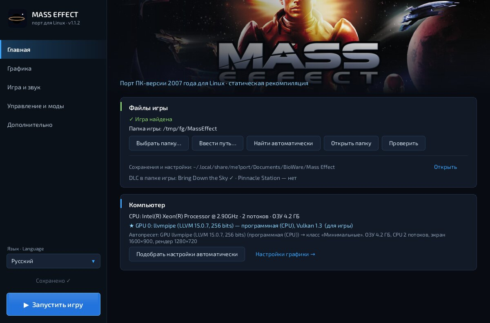

# me1port — Mass Effect (2007) на Android и Linux

**v1.2.18** · Android 10+ (arm64-v8a) · Linux x86-64 / aarch64 (X11, Wayland) · OpenGL ES 3 / Vulkan 1.0

Это порт оригинальной PC-версии Mass Effect на Android и Linux через **статическую перекомпиляцию**. Код `MassEffect.exe` и его DLL
(x86-32) переводится в C и собирается под ARM64. Вокруг него работает рантайм, который заменяет Windows, Direct3D 9 и звук.
Эмулятора x86 и Wine здесь нет.

> *English:* static recompilation port of the original PC Mass Effect (2007) to Android/ARM64 and desktop Linux (x86-64/aarch64, SDL2). x86-32 PE → C → arm64,
> plus an HLE runtime (Win32, Direct3D 9 → GLES 3 / Vulkan, own OpenAL 1.1 → AAudio). No game data is included: you need your own
> copy of the PC game. The launcher UI is available in RU, EN, DE, FR, IT, ES, PL, CS and HU.

---

## Содержание

- [Как это устроено](#как-это-устроено)
- [Для игрока](#для-игрока)
- [Linux](#linux)
- [Структура репозитория](#структура-репозитория)
- [Сборка](#сборка)
- [Тесты](#тесты)
- [Локализация лаунчера](#локализация-лаунчера)
- [Документация](#документация)
- [Правовые замечания](#правовые-замечания)

---

## Как это устроено

```
 MassEffect.exe, msvcr80/msvcp80, d3dx9_31, PhysXCore, ogg/vorbis, binkw32   (x86-32 PE, из вашей копии игры)
        │  tools/recomp.py  (capstone → C: целочисленная ISA, флаги, x87/SSE/MMX, таблицы переходов, SEH/C++ EH)
        ▼
 out/<модуль>/*.c  ──► NDK clang (arm64, -fPIC) ──► libme1game.so
        │
        ├── runtime/   HLE-рантайм: Win32 (файлы, потоки, синхронизация, реестр, SEH), виртуальная память,
        │              Direct3D 9 → OpenGL ES 3 (шейдеры SM3 → GLSL) или собственный рендерер D3D9 → Vulkan,
        │              свой программный OpenAL 1.1 (для ISACT) с выводом в AAudio, ввод, моды (VFS-оверлей), PhoneModify
        ├── settings/  настройки движка и порта (замена MassEffectConfig.exe), утилита me1cfg
        ├── android/   лаунчер (Java), JNI, GLSL → SPIR-V (glslang), необязательно Mesa Zink и libadrenotools
        └── linux/     фронтенд на SDL2 (окно X11/Wayland, ввод, геймпады, звук, экран загрузки) → me1-linux;
                       лаунчер me1-launcher (настройки, моды, запуск)
```

- Игра запускается в отдельном процессе (`:game`), на весь экран. Лаунчер выбирает настройки, драйвер, моды и управление.
- Шейдеры D3D9 компилируются перекомпилированным D3DX (HLSL), транслируются в GLSL или SPIR-V и кэшируются.
  Поэтому первый запуск занимает несколько минут.
- Графика: системный OpenGL ES (по умолчанию на Android), системный Vulkan через собственный рендерер (по умолчанию
  на ПК с видеокартой), Mesa Zink или пользовательские Vulkan-драйверы (Turnip, сборки Qualcomm и Mali в формате AdrenoTools).
- **v1.2.18**: Добавлена настройка режима экрана: «По размеру» (Fit), «Растянуть» (Stretch), «Заполнить» (Fill).

---

## Для игрока

### Что нужно

- Телефон или планшет на **arm64** с **Android 10** или новее, GPU с OpenGL ES 3.x (или Vulkan 1.0 для Vulkan-рендерера).
- **Своя копия PC-версии Mass Effect (2007/2008)**. Legendary Edition не подходит: это другая игра и другой движок.
- Место под игру во внутренней памяти или на SD-карте.

Проверено на Helio G85 (Mali-G52) и Snapdragon 8 Gen 1 (Adreno 730). Работают и другие устройства с Mali и Adreno.
Лаунчер сам определяет класс устройства (GPU/SoC, ОЗУ, частота CPU, экран) и подбирает пресет.

### Установка

1. Установите `me1port-launcher-v1.0.apk`. Обновление ставится поверх старых версий, настройки сохраняются.
2. Скопируйте папку игры (с `Binaries`, `BioGame`, …) в **`/sdcard/MassEffect`**. Подойдут и папки
   «Mass Effect», «MassEffect 1» и т. п. в корне памяти или SD-карты, в том числе на уровень глубже.
3. Откройте лаунчер и разрешите доступ к файлам. На Android 11+ нужен «Доступ ко всем файлам».
4. Проверьте строку «✓ Игра найдена». При первом запуске настройки подбираются автоматически.
5. Нажмите **«Запустить игру»**.

Сохранения и настройки игры лежат в `/sdcard/Documents/BioWare/Mass Effect/`, главный лог — в `Documents/me1exe_run.log`.

### Возможности лаунчера

- **Язык интерфейса** (кнопка 🌐 рядом с заголовком): русский, английский, немецкий, французский, итальянский,
  испанский, польский, чешский, венгерский. Заодно можно переключить язык текста в самой игре.
- **Пресеты** от «Минимальных» до «Максимальных», автопресет и все настройки движка (разрешение, тени, текстуры,
  масштаб 3D-сцены, ограничение FPS, «Упрощённый расчёт» для слабых GPU).
- **Графический драйвер**: системный GLES или Vulkan, Mesa Zink, свои драйверы из `MassEffect/GameExDriver/`.
- **Нагрузка (GEARMASS, v1.2.1)**: как порт распределяет работу по ядрам — «Авто» (по замерам во время игры: что
  тормозит, CPU или GPU, и насколько горячо), «Эконом», «Баланс», «Производительность», «Максимум», «Своя»;
  индикатор под счётчиком FPS. Без списков устройств: всё подбирается по ядрам, частотам и замерам.
- **Управление**: сенсорное (стик, кнопки, камера свайпом, настраиваемая раскладка), USB/Bluetooth-клавиатура и мышь,
  геймпад XInput (нужен мод ME1Controller). С v1.1.3 есть раскладка «как в порте Skyrim»: экранный Xbox-геймпад, стик
  на всю левую половину экрана и кнопка клавиатуры телефона. Работает и с модом, и без него (тогда как клавиатура и мышь).
  С v1.2 есть своя раскладка, как в Winlator: любые кнопки, стики, крестовины, тачпады и ряды клавиш в любом месте
  экрана, редактор прямо в игре, профили `.icp` (импорт и экспорт, совместимы с Winlator), встроенный профиль «Mass Effect».
- **Моды**: `MassEffect/Mods/<имя>/` подключаются виртуально, оригинальные файлы не меняются. DLC подхватываются из папки игры.
- **PhoneModify**: точечное снижение нагрузки (лимиты draw call, ключи движка, патчи) и генератор готовых профилей.
- **Диагностика**: «Проверить» (что увидит игра), лог последнего запуска, тест без окна, «Доп. переменные» `ME1_*`.

Подробно об этом рассказано в [справочнике](docs/GUIDE.md): моды, драйверы, PhoneModify, все переменные, рецепты для
конкретных GPU, разбор лога и FAQ.

---

## Linux

С v1.1 тот же рантайм и те же перекомпилированные модули собираются в обычную программу для Linux: **`me1-linux`**
(x86-64 или aarch64, X11 или Wayland, Vulkan или OpenGL ES 3 через EGL). Вместо JNI работает фронтенд на SDL2
(`linux/me1_linux.c`) с экраном загрузки, а вместо Android-лаунчера — **`me1-launcher`** с теми же разделами: папка
игры, графика и пресеты, звук, управление, моды, переменные окружения, PhoneModify, проверка и журналы. Wine, DXVK и
эмулятор не нужны.

```sh
make linux-demo                                  # me1-demo: окно, ввод, звук и рендереры без файлов игры
# перекомпиляция своих файлов игры: раздел «Сборка», шаг 1
make -j$(nproc) linux                            # build/linux/me1-linux, me1-launcher, me1cfg, libme1spv.so
linux/install.sh                                 # установка в ~/.local и ярлык «Mass Effect» в меню
me1-launcher                                     # или ярлык; me1-launcher --play — сразу в игру
```



Подробно о требованиях, пакетах, параметрах и ограничениях: [linux/README.md](linux/README.md).

---

## Структура репозитория

| Путь | Что там |
|---|---|
| `tools/recomp.py` | статический перекомпилятор x86-32 PE → C (`fpsse.py`: x87/SSE/MMX, `ehscan.py`: SEH/C++ EH, `pefile_min.py`) |
| `tools/ilt_seeds.py`, `tools/seeds/` | точки входа из ILT-таблиц для `--seeds` |
| `tools/difftest.py` | дифференциальный тест перекомпилятора против Unicorn (x86-хост и arm64 под qemu) |
| `runtime/` | HLE-рантайм: `rt*.c` (ядро, FP), `hle_win32/sys/fs/thread/seh/vmem/exe.c`, `hle_d3d9.c` (+ `_gl.h`, `_vk.h`, буфер команд `_cmd.c`), `gearmass.c` (распределение нагрузки, пул рабочих потоков), `sm3_glsl.c`, `hle_al.c`, `hle_input.c`, `hle_mod.c`, `hle_hb.c` (профайлер), `test_*.c` |
| `settings/` | `ini.c`, `me1settings.c` (схема настроек, пресеты, автопресет), `me1cfg_cli.c` |
| `android/src/com/me1port/launcher/` | лаунчер: `MainActivity`, `GameActivity`, `ControlsOverlay/Settings`, `Pad`, `GameLocator`, `GpuDrivers`, `DeviceInfo`, `L` (локализация) |
| `android/jni/` | JNI-мосты (`me1port_jni.c`, `game_jni.c`), `run_main.c` (тест без окна), `vkshim.c`, `me1spv.c` (GLSL → SPIR-V) |
| `android/gpu/` | сборка Mesa 26.2.6 (Zink) и libadrenotools: `build_gpu.sh`, патч Mesa |
| `android/assets/` | `loading.jpg`, `i18n/*.json` (переводы) |
| `android/i18n/` | исходники переводов `tr/<код>.txt` и `build_tr.py` |
| `android/test/` | хостовые JVM-тесты JNI, поиска игры и драйверов |
| `android/build_apk.sh` | сборка APK без Gradle |
| `linux/` | порт на Linux: `me1_linux.c` (фронтенд SDL2, экран загрузки), `launcher.c` (лаунчер), `ui.c` (интерфейс), `i18n.c` + `i18n/` (переводы), `gpuprobe.c`, `assets/` (шрифты, иконка), `demo_d3d9.c` (проверка без игры), `install.sh`, `.desktop`, `README.md` |
| `runtime/me1_platform.h` | описание окна платформы (Android / X11 / Wayland) для рендереров |
| `tests/` | генераторы тестовых DLL (потоки, исключения), нативные тесты |
| `docs/GUIDE.md` | справочник пользователя |
| `docs/ARCHITECTURE.md`, `docs/ARCHITECTURE.pdf` | как устроен исходный код: кратко и подробно |
| `docs/img/` | скриншоты |
| `PERF.md` | аудит производительности и загрузки |
| `CHANGES_v*.md` | изменения по версиям |

`out/` (сгенерированный C-код) и `build/` в репозиторий не входят: они получаются из вашей копии игры.

---

## Сборка

### Инструменты

| Что | Версия / примечание |
|---|---|
| Linux x86-64, `make`, `gcc` | хостовые тесты и утилиты; для порта на Linux ещё SDL2 (см. [linux/README.md](linux/README.md)) |
| Python 3 + `capstone` | перекомпилятор; для `difftest` ещё `unicorn` и `qemu-aarch64-static` |
| Android NDK | r27c (`NDK=/path/android-ndk-r27c`) |
| Android SDK | build-tools 30.0.3, platform android-29 (`ANDROID_SDK`, `ANDROID_BT`, `ANDROID_JAR`) |
| JDK | 17 (`JAVA_HOME`) |
| glslang | 15.0.0, собранный под Android (`GLSLANG_SRC`), для `libme1spv.so` |
| meson ≥ 1.4, ninja, cmake, bison, flex, mako | только для `android/gpu/build_gpu.sh` (Zink и adrenotools, необязательно) |

### 1. Перекомпиляция модулей игры

Модули берутся из вашей установки игры (`Binaries/`). Команды повторяют комментарии в `Makefile`:

```sh
python3 tools/ilt_seeds.py  /path/MassEffect.exe tools/seeds/MassEffect_ilt_funcs.txt
python3 tools/recomp.py /path/MassEffect.exe  out/exe       --prefix m   --seeds tools/seeds/MassEffect_ilt_funcs.txt
python3 tools/recomp.py /path/msvcr80.dll     out/msvcr80   --prefix crt
python3 tools/recomp.py /path/msvcp80.dll     out/msvcp80   --prefix cpp
python3 tools/recomp.py /path/d3dx9_31.dll    out/d3dx9     --prefix dx  --code-ranges 2b005-21e0a8
python3 tools/recomp.py /path/PhysXCore.dll   out/physxcore --prefix pxc --base 12000000
python3 tools/recomp.py /path/ogg.dll         out/ogg       --prefix ogg --base 10100000
python3 tools/recomp.py /path/vorbis.dll      out/vorbis    --prefix vb  --base 10200000
python3 tools/recomp.py /path/vorbisfile.dll  out/vorbisfile --prefix vf --base 10300000
python3 tools/recomp.py /path/binkw32.dll     out/bink      --prefix bk  --base 10400000
```

### 2. Нативные библиотеки

```sh
make game-lib                         # build/android/libme1game.so + libme1run.so
make build/android/libme1spv.so       # GLSL → SPIR-V для Vulkan-рендерера
sh android/gpu/build_gpu.sh           # необязательно: Mesa Zink + libadrenotools → build/android/gpu
```

### 3. APK

```sh
make apk                              # или: sh android/build_apk.sh
# → android/out/me1port-launcher.apk
```

`build_apk.sh` собирает `libme1port.so` и `libme1vkshim.so`, затем добавляет `libme1game.so`/`libme1run.so`,
`libme1spv.so`, GPU-библиотеки, `d3dx9_31.dll` (`D3DX_DLL=…`) и `assets/`. Дальше идут javac → d8 → aapt2 →
zipalign → apksigner. Переменные: `NO_EXE=1` (без игры), `NO_GPU=1` (без Zink/adrenotools), `NO_D3DX=1`, `KEYSTORE=…`.

APK подписывается ключом `android/keystore/me1port-debug.keystore` (пароль `android`, alias `me1port`). Так новые
версии ставятся поверх старых. Ключ публичный и подходит только для отладочных сборок. Для своих релизов используйте свой ключ.

Если менялись только Java-код или переводы, NDK не нужен. Скомпилируйте Java, возьмите `lib/` и `assets/d3dx9_31.dll`
из предыдущего APK и выполните шаги 2–6 из `build_apk.sh`.

---

## Тесты

```sh
make difftest              # перекомпилятор против Unicorn на x86-хосте
make difftest-arm64        # то же для arm64 под qemu-aarch64-static
make test-mt test-eh       # потоки/синхронизация и SEH/C++-исключения на тестовых DLL
make test-vorbis test-bink # перекомпилированные декодеры звука и видео
make build/test_d3d9 build/test_fs build/test_mod build/test_al   # HLE D3D9, файловый слой, моды, звук
for m in 0 1 2; do ME1_GL_FAKEWIN=128x128 ME1_D3D_CMD=$m ME1_D3D_CMD_CHECK=1 build/test_cmd; done   # make build/test_cmd: буфер команд, CRC кадра одинаковая во всех режимах
for w in 0 1 2 4; do ME1_GM_WORKERS=$w ME1_GM_QUALITY=0 ME1_D3D_CMD=2 build/test_cmd; done   # GEARMASS: CRC не зависит от числа рабочих потоков (test_cmd 30 dxt — замер распаковки DXT)
make build/test_gm && build/test_gm   # GEARMASS: пул потоков, пресеты, классы, политика «Авто», переменные
make linux-demo && ME1_DEMO_SECONDS=10 build/linux/me1-demo --game /tmp/me1demo  # Linux-фронтенд и рендереры без игры (нужна пустая папка Binaries/)
```

`android/test/*.java` — хостовые JVM-тесты моста JNI (`HostTest`), поиска игры (`LocatorTest`) и пакетов драйверов
(`DriversTest`) на x86-64-сборке `libme1port.so`.

На устройстве есть «Тест без окна» в лаунчере: тот же `MassEffect.exe` без окна, кадры сохраняются в `Documents/me1_frames`.

---

## Локализация лаунчера

- Исходные строки в Java — на русском, они же служат ключами: `L.t("…")`. Куски нативных сообщений переводит `L.tx()`,
  схему настроек — `L.schema()`.
- Переводы лежат в `android/assets/i18n/<код>.json`, их исходники — в `android/i18n/tr/<код>.txt` в формате `ID|текст`
  (`J` — строки Java, `S` — схема настроек, `F` — нативные фрагменты, `X` — выбор языка). Пробелы и переводы строк
  по краям берутся из ключа автоматически, `\n` означает перевод строки.
- После правки выполните `python3 android/i18n/build_tr.py en de fr it es pl cs hu`. Скрипт проверит, что все строки на месте и
  совпадают спецификаторы `%s`/`%.1f`. Ключи, которых нет в `tr/*.txt` (добавленные прямо в JSON, например описания
  «Доп. переменных»), скрипт сохраняет (v1.2.1).
- Если строки нет в переводе, показывается английский вариант, а если нет и его — русский оригинал. Описания
  «Доп. переменных» и комментарии в `phone_tune.txt` переведены только на английский.
- Linux-лаунчер берёт те же `android/assets/i18n/*.json` (вшиты в бинарник) и добавляет свои строки из
  `linux/i18n/<код>.json` (`{"русский оригинал": "перевод"}`): английский — полностью, остальные языки — основные пункты.

---

## Документация

- [docs/ARCHITECTURE.md](docs/ARCHITECTURE.md): как всё работает под капотом, кратко. Подробная версия: [docs/ARCHITECTURE.pdf](docs/ARCHITECTURE.pdf) (исходник `docs/ARCHITECTURE_full.md`).
- [docs/GUIDE.md](docs/GUIDE.md): справочник (моды, драйверы GPU, PhoneModify, настройки, переменные `ME1_*`, рецепты, лог, FAQ).
- [PERF.md](PERF.md): аудит производительности и загрузки с замерами.
- [docs/PLAN_v1.2.1.md](docs/PLAN_v1.2.1.md): план 1.2.1 GEARMASS «CPU и GPU не простаивают» — распараллеливание на все ядра, режимы нагрузки, «Авто»; что сделано и что осталось.
- [linux/README.md](linux/README.md): порт на Linux.
- [CHANGES_v1.2.md](CHANGES_v1.2.md), [CHANGES_v1.1.md](CHANGES_v1.1.md), [CHANGES_v1.0.md](CHANGES_v1.0.md), [CHANGES_v0.10.13.md](CHANGES_v0.10.13.md): изменения.

---

## Правовые замечания

- Mass Effect — товарный знак Electronic Arts / BioWare. Проект с ними не связан.
- В репозитории **нет файлов игры** и нет сгенерированного из них кода (`out/`). Для сборки и игры нужна своя
  легально купленная копия PC-версии. Не публикуйте `out/`, `build/` и APK с `libme1game.so`: они содержат код,
  полученный из бинарников игры.
- `d3dx9_31.dll` (DirectX) берётся из вашей установки и кладётся в APK как ресурс.
- Раскладка «как в порте Skyrim» написана заново по описанию и скриншотам того порта. Его код не копировался: у
  репозитория нет лицензии.
- Сторонние компоненты: capstone (BSD), glslang (BSD/Apache-2.0), Mesa (MIT), libadrenotools (BSD-2-Clause). Их лицензии действуют
  на соответствующие части.


**v1.2.2:** редактор экранных раскладок, «Быстрая настройка» и доработки GEARMASS; подробности и ограничения — [план v1.2.2](docs/PLAN_v1.2.2.md).

**v1.2.3:** добровольное авторазрешение между сеансами и экспериментальный Vulkan pipeline; проверки и незавершённые этапы — [план v1.2.3](docs/PLAN_v1.2.3.md).


**v1.2.11:** исправлены крайние случаи FSCALE и зависимость округления x87/SSE от режима хоста. Изменён только runtime, регенерация кода игры не требуется. Аппаратные тесты пройдены на x86-64; игра и телефон не проверены. GEARMASS и весь план ещё не завершены — [план и ограничения](docs/PLAN_v1.2.11.md).

**v1.2.12:** исправлены флаги FRNDINT и добавлена проверка x87 на аппаратном x86-64. GEARMASS и общий план не завершены; телефон и игра не проверены. [План и ограничения](docs/PLAN_v1.2.12.md).

**v1.2.17:** добавлен аудит встроенных x87-инструкций относительно аппаратного x87 (значения, TOP, флаги); runtime не менялся. Реальный телефон, ARM и игра не проверены; проект не завершён. [План и ограничения](docs/PLAN_v1.2.17.md).

**v1.2.16:** FXTRACT и FSCALE сбрасывают C1, а FSCALE ставит флаги переполнения/потери значимости по 80-битному диапазону, как аппаратный x87. Реальный телефон, ARM и игра не проверены; проект не завершён. [План и ограничения](docs/PLAN_v1.2.16.md).

**v1.2.15:** FPREM/FPREM1 теперь обновляют биты C0–C3 как аппаратный x87 при NaN, недопустимой операции и частичной редукции. Реальный телефон, ARM и игра не проверены; проект не завершён. [План и ограничения](docs/PLAN_v1.2.15.md).

**v1.2.14:** FRNDINT/FISTP в режимах «вниз»/«вверх» больше не зависят от режима округления хоста (неверный знак нуля исправлен). Реальный телефон, ARM и игра не проверены; проект не завершён. [План и ограничения](docs/PLAN_v1.2.14.md).

**v1.2.13:** GEARMASS учитывает пропавшие после обнаружения датчики sysfs и предупреждает о неполных данных. Реальный телефон и игра не проверены; проект не завершён. [План и ограничения](docs/PLAN_v1.2.13.md).
