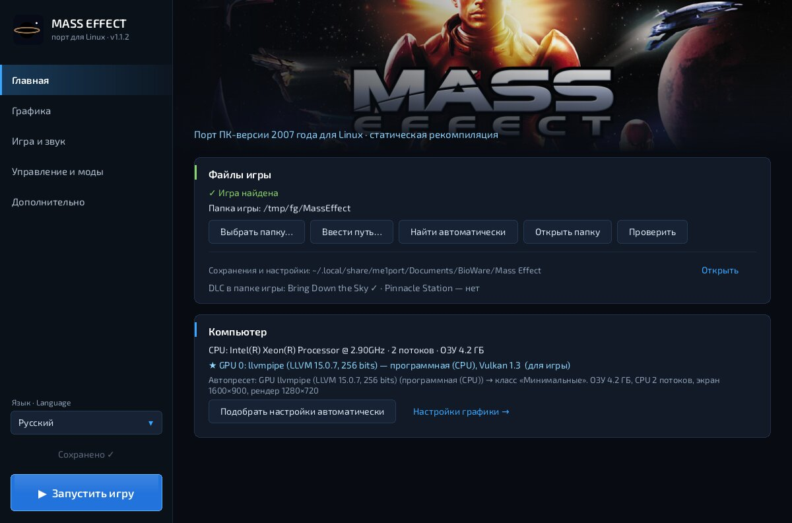
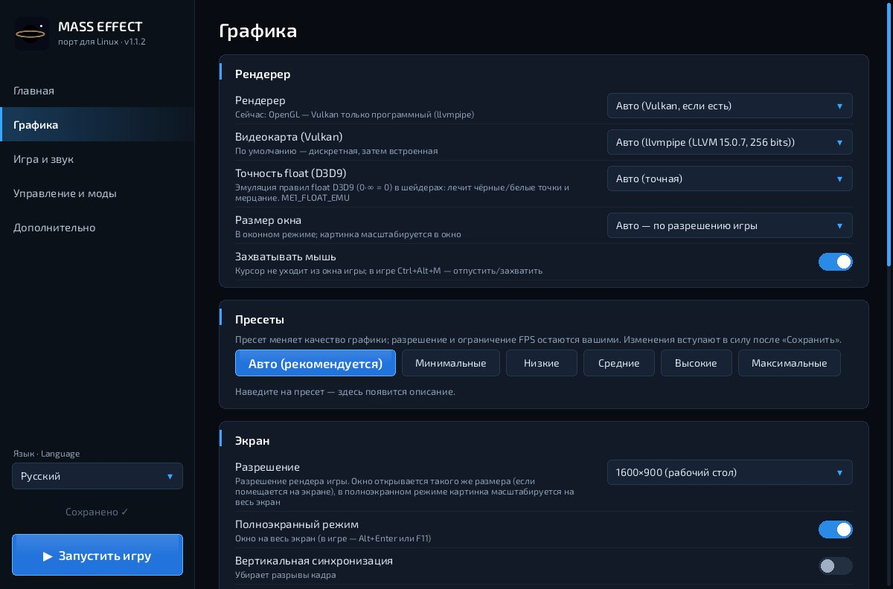
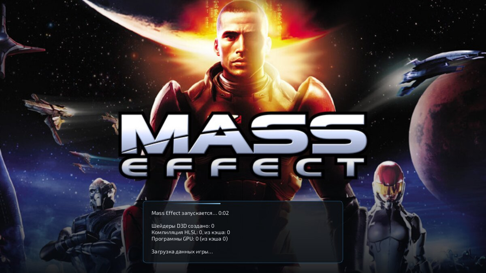
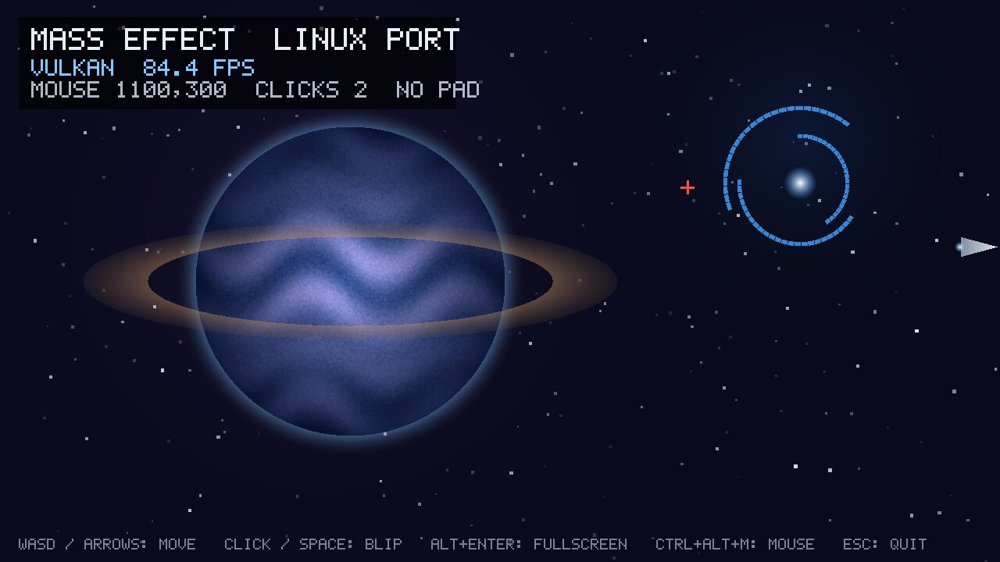
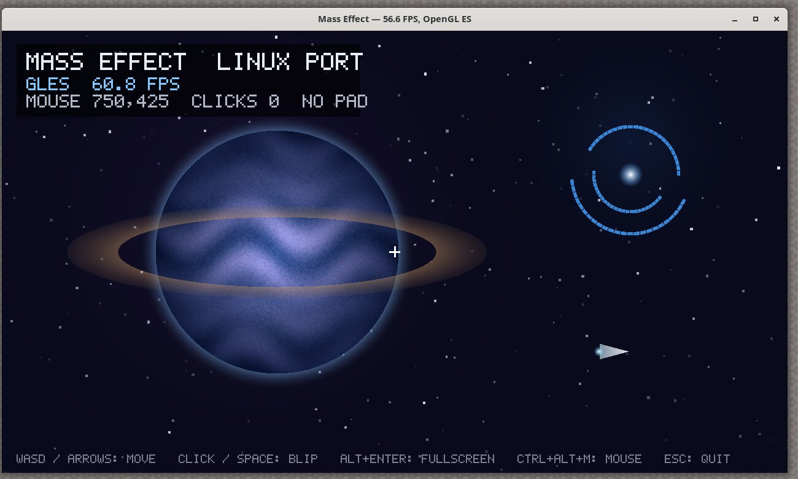

# me1port для Linux

**v1.1.3** · x86-64 и aarch64 · X11 и Wayland · Vulkan / OpenGL ES 3 · SDL2

Тот же порт, что и для Android, но в виде обычной программы для Linux. Код `MassEffect.exe` и его DLL статически
переведён в C (`tools/recomp.py`) и собирается в один исполняемый файл **`me1-linux`** под процессор вашего компьютера.
Рантайм `runtime/` заменяет Windows, Direct3D 9, OpenAL, DirectInput и XInput. Вместо `GameActivity` и JNI здесь работает
фронтенд на SDL2 (`linux/me1_linux.c`): окно, клавиатура и мышь, геймпады и звук. Wine, DXVK и эмулятор x86 не нужны.

**`me1-launcher`** — лаунчер, как в Android-версии: папка игры, графика и пресеты, звук, управление, моды и DLC,
PhoneModify, переменные окружения, проверка, журналы, кэш шейдеров. Ярлык «Mass Effect» в меню приложений открывает
именно его. Во время запуска игры показывается **экран загрузки** с ходом компиляции шейдеров.



---

## Что нужно

- **PC-версия Mass Effect** (диск, Steam, EA App/Origin): папка игры с `Binaries/` и `BioGame/`. Код перекомпилируется
  под конкретную сборку `MassEffect.exe`: используйте те же файлы, что и для шага 2 ниже.
- `msvcr80.dll`, `msvcp80.dll` (Visual C++ 2005 SP1) и `d3dx9_31.dll` (DirectX, апрель 2006). Положите их в
  `<игра>/Binaries/` или укажите через `--images` / `ME1_D3DX_DLL`.
- Linux x86-64 или aarch64 (Raspberry Pi 5, Ampere, Snapdragon X, Asahi и т. п.) с драйвером, который умеет
  **OpenGL ES 3.0+ через EGL** (Mesa, NVIDIA, AMD — да) или **Vulkan 1.0+**.
- Для сборки: `gcc` или `clang`, `make`, `python3` + `capstone`, `SDL2` (dev-пакет). Для Vulkan-рендерера ещё `glslang`
  (статические библиотеки) и `SPIRV-Tools`.

| Дистрибутив | Пакеты |
|---|---|
| Debian / Ubuntu | `build-essential python3-capstone libsdl2-dev libegl-dev glslang-dev spirv-tools` |
| Fedora | `gcc make python3-capstone SDL2-devel mesa-libEGL-devel glslang-devel spirv-tools-devel` |
| Arch | `base-devel python-capstone sdl2 glslang spirv-tools` |

Сборщик сам ищет glslang (`tools/build_spv_host.sh`): статические библиотеки в `/usr/lib/<платформа>` (Debian/Ubuntu,
в том числе glslang 11 из Ubuntu 22.04), `/usr/lib64`, `/usr/local/lib*` или общие `.so` (Fedora, Arch). Если glslang не найден,
`make linux` печатает подсказку и продолжает без `libme1spv.so`: работает только OpenGL ES, а `--renderer vulkan`
переключается на GL (Vulkan-рендерер на ПК выбирается по умолчанию, поэтому glslang лучше поставить). Свою сборку glslang можно указать так: `make linux GLSLANG_LIBDIR=… GLSLANG_CFLAGS=-I…`.

В рантайме нет зависимостей от X11, Wayland и Vulkan на этапе компоновки: `libEGL`, `libvulkan`, `libX11`,
`libwayland-egl` подгружаются через `dlopen`. Исполняемый файл ссылается только на `libSDL2`, `libm` и `libc`.

## Сборка

```sh
# 1. проверка фронтенда без игры (окно, ввод, звук, оба рендерера)
make linux-demo              # → build/linux/me1-demo, me1-launcher, libme1spv.so
mkdir -p /tmp/me1demo/Binaries && ./build/linux/me1-demo --game /tmp/me1demo --windowed   # Esc — выход

# 2. перекомпиляция ваших файлов игры в C (один раз, ~10–20 минут)
tools/recomp_all.sh "<игра>/Binaries" "<папка с msvcr80.dll, msvcp80.dll, d3dx9_31.dll>"

# 3. сборка игры
make -j$(nproc) linux        # → build/linux/me1-linux, libme1spv.so, me1cfg

# 4. установка в ~/.local: me1-launcher, me1-linux, me1cfg, ярлык «Mass Effect» в меню приложений
linux/install.sh --game "<игра>"        # --game можно не указывать: папку выберет лаунчер
```

Обновление до новой версии исходников: распакуйте архив поверх старой папки (перекомпилированный `out/` сохранится),
затем `make -j$(nproc) linux && linux/install.sh`. Шаг 2 повторять не нужно.

На aarch64 команды те же: `Makefile` сам добавляет `-fsigned-char -march=armv8.2-a+rcpc` (для Raspberry Pi 4 и других
ядер ARMv8.0: `make linux ARM_FLAGS=-march=armv8-a`). Сборка всех модулей (~2 млн строк C) занимает 10–40 минут в
зависимости от числа ядер. `EXEOPT=-O2` даёт более быстрый код ценой ещё более долгой сборки.

## Лаунчер

`me1-launcher` (или ярлык «Mass Effect»). Все настройки пишутся туда же, куда их пишет Android-лаунчер и `me1cfg`
(`BIOEngine.ini`, `BIOGame.ini`, `BIOInput.ini`, `me1port.ini` в `<docs>/BioWare/Mass Effect/`), собственные — в
`~/.config/me1port/launcher.ini`.

| Вкладка | Что там |
|---|---|
| Главная | папка игры: выбрать (диалог zenity/kdialog/yad), ввести путь, найти автоматически, проверить; DLC; процессор, ОЗУ и видеокарты (Vulkan); «Подобрать настройки автоматически» |
| Графика | рендерер (авто / Vulkan / OpenGL / zink), видеокарта Vulkan, точность float D3D9, размер окна, захват мыши; пресеты (разрешение и лимит FPS не трогают); экран, графика, параметры порта |
| Игра и звук | язык текста, субтитры, сложность, автосохранение; звуковое устройство, число каналов |
| Управление и моды | геймпад (нужен мод ME1Controller — включается здесь), чувствительность мыши, моды из `<игра>/Mods` |
| Дополнительно | переменные окружения (со списком и описаниями), генератор и папка PhoneModify, «Что увидит игра», журнал последнего запуска, очистка кэша шейдеров, сброс настроек, масштаб интерфейса, о программе |

Язык интерфейса: русский, English (полностью), Deutsch, Français, Italiano, Español, Polski, Čeština, Magyar (основные
пункты, остальное — по-английски). При первом запуске с найденной игрой лаунчер сам подбирает пресет и разрешение
(разрешение рабочего стола) по видеокарте.

Клавиши: `Ctrl+S` — сохранить, `Ctrl+Enter` / `F5` — играть, `Ctrl+колесо` и `Ctrl+=`/`Ctrl+−`/`Ctrl+0` — масштаб.
На время игры окно лаунчера скрывается и возвращается после выхода из неё. Если игра завершилась с ошибкой, лаунчер
предлагает открыть журнал. `me1-launcher --play` — сразу запустить игру (так работает пункт «Сразу играть» в меню
ярлыка), `--game DIR` — папка игры, `--lang CODE` — язык.



### Экран загрузки

От старта до первого кадра игры (на первом запуске это несколько минут: компиляция шейдеров) окно показывает картинку
из Android-лаунчера и ход загрузки: время, созданные шейдеры D3D, компиляцию HLSL (из кэша / заново), программы GPU.
Отключается `--no-loading-screen` или `ME1_NO_LOADING=1`.



## Запуск без лаунчера

```sh
me1-linux                                   # папка игры из лаунчера / install.sh --game
me1-linux --game ~/Games/MassEffect --renderer vulkan --fullscreen
me1-linux --game ... -- -nostartupmovies    # после «--» — аргументы самой игры
```

| Параметр | Что делает |
|---|---|
| `--game DIR` | папка игры (иначе `$ME1_GAME`, `~/.config/me1port/game_dir` — её запоминают лаунчер и `install.sh --game`, текущая папка) |
| `--docs DIR` | «Мои документы» игры: сохранения, `BIO*.ini`, журнал. По умолчанию `~/.local/share/me1port/Documents` |
| `--renderer vulkan\|gl\|zink` | рендерер. По умолчанию `vulkan`, если есть видеокарта с Vulkan (не программный lavapipe) и `libme1spv.so`, иначе `gl` (OpenGL ES через EGL). Если Vulkan не запустился, игра сама переходит на GL. Видеокарта: дискретная, затем встроенная; выбрать — `ME1_VK_DEVICE=N` |
| `--fullscreen`, `--windowed` | полный экран или окно (по умолчанию — как «Полноэкранный режим» в настройках). `Alt+Enter` / `F11` переключают режим на ходу |
| `--window WxH` | размер окна (по умолчанию — разрешение игры, если помещается на экран) |
| `--no-loading-screen`, `--lang CODE` | без экрана загрузки; язык экрана загрузки (по умолчанию — как в лаунчере, иначе язык системы) |
| `--screen WxH` | «рабочий стол», который видит игра (по умолчанию — разрешение монитора). Разрешение рендера задаётся в настройках игры, картинка вписывается в окно с полосами |
| `--fps-limit N`, `--show-fps` | ограничение FPS и счётчик в заголовке окна |
| `--no-grab` | не захватывать мышь (системный курсор; обзор мышью упирается в края окна) |
| `--video x11\|wayland` | оконная система. По умолчанию SDL выбирает X11 (на Wayland — XWayland); `wayland` — нативно |
| `--mods A:B`, `--images DIR` | моды (как `ME1_MODS`); папка с `image.bin` модулей |
| `--log FILE\|-`, `-v` | журнал (по умолчанию `<docs>/me1exe_run.log`); `-` — в терминал, `-v` — в оба места |
| `--env K=V` | любая переменная рантайма (`ME1_HB=10`, `ME1_SHADER_LITE=1`, `ME1_VSYNC=0` …, см. `docs/GUIDE.md`) |

**Первый запуск** долгий: игра компилирует свои HLSL-шейдеры перекомпилированным `d3dx9_31.dll` (ход виден на экране
загрузки). Результаты кэшируются в `<docs>/me1_hlsl_cache` и `~/.cache/me1port/gl_cache`, следующие запуски быстрые.
Если при самом первом запуске `me1port.ini` ещё нет, разрешение игры ставится равным разрешению рабочего стола.

**Точность float.** На ПК по умолчанию включена точная эмуляция правил float из D3D9 (`ME1_FLOAT_EMU=2`: `0·∞ = 0`
в mul/mad/dp, ограничение rcp/rsq/log/pow). Без неё на части драйверов (в том числе RADV) появляются чёрные и белые
точки и мерцание. `ME1_FLOAT_EMU=1` чуть быстрее, `0` — без эмуляции (в лаунчере: «Графика → Точность float»).

**Запросы видимости (v1.1.3).** Движок проверяет через occlusion queries, виден ли объект, и по их результату
задаёт яркость и размер бликов линз. До v1.1.3 игра всегда получала ответ «видно». Поэтому ничего не отсекалось (лишняя
нагрузка на GPU), а блики от ламп и солнца светили сквозь стены. Теперь используются настоящие запросы GPU. Если
появятся подтормаживания, попробуйте `ME1_OCCLUSION=2` (не ждать GPU, результат на кадр позже). `ME1_OCCLUSION=0`
возвращает старое поведение. Сами блики и bloom выключаются в лаунчере: «Графика → Блики линз / Свечение (bloom)».

**Настройки** графики, звука и управления — лаунчер или `me1cfg` (замена `MassEffectConfig.exe`):

```sh
me1cfg --game ~/Games/MassEffect --docs ~/.local/share/me1port/Documents preset high
me1cfg ... set screen.resolution=2560x1440 gfx.dynamic_shadows=1
me1cfg ... show
```

`port.simple_shaders`, `port.fps_limit`, `port.show_fps` и `port.phone_mod` из `me1port.ini` фронтенд тоже учитывает
(Android-ограничение 30 FPS по умолчанию на ПК не включается, только если оно задано явно; на ПК по умолчанию `0` — без
ограничения).

## Управление

| Ввод | Что происходит |
|---|---|
| Клавиатура | физические клавиши (как DirectInput на Windows, раскладка не важна): WASD и т. д. Текст в консоли и полях ввода — с учётом раскладки (WM_CHAR) |
| Мышь | захватывается щелчком по окну (relative mode): обзор без упора в края, курсор меню двигается внутри картинки. `Ctrl+Alt+M` — отпустить/захватить, при потере фокуса отпускается сама |
| Колесо, средняя кнопка | WM_MOUSEWHEEL / DirectInput Z, WM_MBUTTON* |
| Геймпад | любой, который знает SDL (Xbox, DualShock/DualSense, Switch Pro, 8BitDo…) → XInput, с вибрацией. В ванильной игре кнопок геймпада нет — нужен мод вроде ME1Controller |
| Закрытие окна | игре отправляется WM_CLOSE (она выходит штатно); повторное закрытие или 15 с без ответа — немедленная остановка с отчётом в журнале |

## Как это устроено

```
 SDL2 (главный поток): окно X11/Wayland, события, звук, геймпады
   │ me1_platform_set(X11|Wayland, Display*/wl_display*)      ── runtime/me1_platform.h
   │ me1gl_set_window(Me1Window*)  {Window или wl_surface, w, h, gen}
   │ hle_ui_key / hle_ui_pointer_rel / hle_ui_wheel / hle_ui_char / hle_xinput_set
   │ hle_al_out_open/start → SDL_OpenAudioDevice, колбэк → hle_al_render()
   ▼
 игровой поток: me1_exe_main() (runtime/main_exe.c, -DME1_LIB)
   └─ MassEffect.exe + msvcr80/msvcp80 + PhysX + D3DX + Vorbis + Bink (перекомпилированный C)
        └─ Direct3D 9 HLE ─┬─ GLES: eglGetPlatformDisplay(X11|Wayland) + eglCreateWindowSurface
                           │        (Wayland: wl_egl_window, ресайз по gen)
                           └─ Vulkan: VK_KHR_xlib_surface | VK_KHR_wayland_surface, новый swapchain по gen
```

- **Экран загрузки.** До первого `Present` окно принадлежит фронтенду: на X11 он рисует программным рендерером SDL
  (XShm, без GL-контекста), на Wayland — GL-рендерером SDL. Рендерер игры получает окно (`me1gl_set_window`) только
  после первого кадра: GL-презентер и Vulkan-swapchain подключаются к окну в любой момент, как на Android. На Wayland
  игре отдаётся новое окно, а библиотека EGL SDL остаётся загруженной: Mesa делит `EGLDisplay` одного `wl_display`
  между SDL и рендерером игры, и `eglTerminate` из SDL сломал бы поверхность игры.
- **Лаунчер** (`linux/launcher.c`) — отдельная программа на SDL2 без GL: immediate-mode интерфейс `linux/ui.c`
  (`stb_truetype`, шрифты Exo 2 и DejaVu вшиты в бинарник), переводы — словари Android-лаунчера
  (`android/assets/i18n/*.json`) плюс свои строки (`linux/i18n/*.json`), опрос видеокарт через Vulkan (`linux/gpuprobe.c`, `dlopen`). Настройки
  читает и пишет тот же код, что и `me1cfg` (`settings/me1settings.c`). Игру запускает как дочерний процесс
  `me1-linux --game … --docs … --lang …` с переменными из вкладки «Дополнительно».

- Рендереры рисуют прямо в окно SDL из своего потока презентации, SDL при этом не создаёт свой GL-контекст.
  На X11 EGL-конфигурация выбирается по visual окна; на Wayland без pbuffer-конфигураций контекст surfaceless.
- Модель памяти x86 (TSO): на x86-64 упорядоченные обращения — обычные `MOV`; на aarch64 — `LDAPR`/`STLR`, как на Android.
- Всё, что не зависит от окна, общее с Android: ФС с поиском без учёта регистра (файлы из Windows-копии игры можно
  не переименовывать), моды, настройки, профайлер `ME1_HB`, кэши шейдеров.

## Проверка без игры: `me1-demo`

`make linux-demo` собирает тот же фронтенд, но вместо `MassEffect.exe` запускает маленькую программу (`linux/demo_d3d9.c`).
Она обращается к рантайму так же, как игра: через COM-таблицы D3D9 и HLE-функции. Рисует сцену (текстура, смешивание,
сотни примитивов), читает ввод через `GetAsyncKeyState`, `GetCursorPos`, `XInputGetState` и играет звук через OpenAL.
Переменная `ME1_DEMO_LOAD=N` задерживает первый кадр на N секунд — так проверяется экран загрузки. Так проверено:

| Что | Результат (Xvfb + Mesa llvmpipe/lavapipe) |
|---|---|
| X11 + GLES | окно 1280×720, ~60 FPS, полный экран и ресайз (картинка вписывается с полосами) |
| X11 + Vulkan | swapchain пересоздаётся при каждом изменении размера окна, ~85 FPS |
| Wayland (Weston) + GLES / Vulkan | `wl_egl_window` / `VK_KHR_wayland_surface`, декорации libdecor |
| Мышь, клавиатура | захват и относительное движение, кнопки, колесо, Alt+Enter, Esc |
| Геймпад | виртуальный контроллер SDL (`ME1_DEMO_VPAD=1`): стики, кнопки, триггеры → XInput |
| Звук | SDL (`SDL_AUDIODRIVER=disk`): 48 кГц стерео, микширование OpenAL HLE без пропусков |
| Экран загрузки | X11 и Wayland, GLES и Vulkan: картинка и счётчики, затем передача окна рендереру без пересоздания (X11) |



*`me1-demo` в Xvfb: окно X11, Vulkan-рендерер на lavapipe.*



*`me1-demo` на Wayland (Weston), OpenGL ES, декорации libdecor.*

## Известные ограничения

- Сама игра на Linux пока не запускалась: здесь нет её файлов. Проверены фронтенд, рендереры, ввод и звук (`me1-demo`)
  и сборка рантайма. Всё остальное — тот же код, что работает на Android.
- На aarch64 Linux сборка не проверялась на реальном железе (код тот же, что в Android-сборке arm64).
- Weston 13 с декорациями libdecor-gtk иногда падает сам (ошибка композитора в `gl_renderer_attach`, воспроизводится и
  без нашего рендерера, если окно часто перерисовывается из другого потока). Если это мешает:
  `SDL_VIDEO_WAYLAND_ALLOW_LIBDECOR=0 me1-linux …` или X11/XWayland. В GNOME и KDE такой проблемы нет.
- `--renderer zink` нужен только для отладки: на ПК лучше родной GLES или Vulkan.
